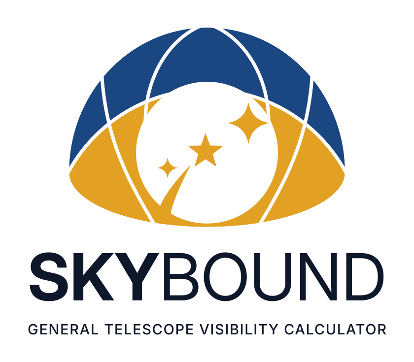

<p align="center">
  <picture>
    <source media="(prefers-color-scheme: dark)" srcset="assets/skybound-lockup-dark.svg">
    
  </picture>
</p>

# SkyBound

A telescope visibility and pointing calculator, made for SPARC4 on the OPD 1.6 m but usable at any site. It shows where the mount can point, when the sky is dark enough, and the night's airmass curve. It also finds the best comparison-star field for SPARC4, does the same for any other instrument (from its Aladin FoV file or its detector's numbers), and plans mosaics.

By Cleber Silva · UFC/MALTED

## Use

Open `index.html` in a browser, either from disk or from the GitHub Pages site. Its sky calculations run in the page, so it needs no installation and no network.

The page opens without a target: the plot shows the night and the Moon until you give one.

1. **Target.** Type a name (a star, exoplanet host, TOI or Gaia DR3 ID) and press *Find*, or type RA/Dec. You can also paste both coordinates into the name box. Names are looked up by the s4field helper when it runs, otherwise online from the browser, otherwise in the reference tables (see below).
   - **Several targets.** Every target you give joins the *Targets* list under the coordinates: a looked-up name keeps its name, coordinates typed by hand become *Target 1*, *Target 2*, … (once both RA and Dec are typed, or on Enter / *Compute*; until then *+ add these coordinates to the list*). Click a target to select it, × to remove it. The list lasts for the session. You can also select a target where you are working: by its name in the airmass plot's legend, or from the target list in the comparison field (above the controls, and in the summary bar once a field is shown).
   - The **selected** target is the one in the RA/Dec boxes: the status, timers, pointing bar and comparison field follow it. The airmass plot shows every target in its own colour, the selected one thicker.
2. **Observatory & night.** Pick the telescope and the date; the arrows step through nights. The site coordinates, pointing-limit CSV and coordinate reduction are under *Site coordinates, pointing limits & coordinate reduction*.
3. **Status**, **Visibility** and the airmass plot follow below. The list of pointing windows is folded away: *Show list* opens it. The plot marks sunset and sunrise (solid) and dusk and dawn at the chosen darkness limit (dashed), with their times.
4. **Field.** Choose the instrument first (*Instrument*, above the target list): SPARC4 is built in; any other comes from a file or the New FoV form (see [Instruments](#instruments-sparc4-and-any-other) below). For SPARC4, the comparison field:
   - **Target:** any target of the list, from the list above the controls or the one in the summary bar (the target's name there is a drop-down list); choosing one selects it on the whole page and computes its field. Fields already computed come back without asking the helper again.
   - **Mode:** photometric or polarimetric; the *?* beside it explains the difference.
   - **Comparison stars: at most** 6 by default (any whole number; 0 = every star that qualifies). The field is chosen for that many: the stars that add most weight. The summary shows e.g. "best 6 of 149".
   - **Basic:** the pointing whose comparison stars are closest in brightness to the target. Nothing else to set.
   - **Advanced:** exposure times (estimated if empty), read-out area, acquisition mode, seeing, sky, Moon, and the airmass at a planned time (a dashed **field** line on the airmass plot) or at the date and time above.
   - The summary bar gives the TCSPD offset, the field centre, the comparisons, η and the **Guider Setup angle** (it follows the guider box when you drag it).
   - **An empty position** (no Gaia star there, such as a pointing test) still gets its field, centred on the position, with a warning: guider and star list, but no comparison stars or η.
   - **The sky view is interactive:** drag to pan, scroll or +/− to zoom, double-click to recentre. Drag the gold field to try another pointing; it is scored when you let go, and turns red if the target falls off it. Drag the blue guider box around its circle to pick the guide star; the Guider Setup angle and the star in the box update as you go. *Recommended* puts both back.

The page remembers the telescope, the instrument, the loaded FoV files and the comparison-field settings in this browser, but not the target.

### Instruments: SPARC4 and any other

The field card works for any instrument. Choose it under *Instrument*. The choice is independent of the telescope, so you can try a visiting instrument, or another telescope's camera, on your targets.

- **SPARC4 (built in).** It uses the measured footprint of the four channels, the polarimetric second image and the guider. s4field ranks the comparison stars in g, r, i and z, in Basic or Advanced mode. Without the helper, SkyBound still draws its footprint and guider on the sky image.
- **Any other instrument**, in either of two ways:
  - ***Load FoV…*** takes the file that Aladin's *File → Load instrument FoV* uses: an XML/VOTable in either of its dialects. The newer one has a `Shape` of `Polygon` (`xPtPosition`, `yPtPosition`) or `Circle` per table; the older ESO/CDS one has `Region = Polygon` tables with `VertexRAOffset`, `VertexDecOffset`. Units of arcsec, arcmin, deg or mas are read.
  - ***New FoV…*** makes a rectangular detector from its numbers: pixels across, pixel size and the telescope's focal length (or the plate scale directly), its centre's offset from the pointing, and optionally a fixed guider box or a guide probe in a patrol annulus. There are presets for the OPD telescopes (1.6 m Perkin-Elmer f/10, 0.6 m Boller & Chivens f/13.5, 0.6 m Zeiss f/12.5) and common Andor and Apogee detectors. An Andor iKon-L 936 gives 0.344″/px and 11.7′ on the B&C, and 0.371″/px and 12.7′ on the Zeiss. These are nominal values: check them against a solved image, since a focal reducer changes them.

  Loaded and new FoVs stay in this browser until you remove them.

  - **Comparison stars** (helper 0.13): s4field ranks them by brightness in the **Band** you choose beside *Field PA*. The bands are V (default), Gaia G, or Gaia's synthetic g, r, i, z. It uses the basic-mode rules: the ΔV window, *at most* N stars, Gaia quality, isolation, and the edge margin on the instrument's own detector(s), so chip gaps are avoided too. There is no exposure model. The summary gives the offset from the target, the comparisons and η in that band.
    - Drag the field to score another pointing; *Recommended* goes back.
    - *Field PA* turns the FoV east of north, 0° by default (its y axis to the north), and the field is scored again.
  - ***Regions…*** lists the regions with the role SkyBound gave each:
    - **science**: the detector(s), where a star is "in the field";
    - **guider**: a guide camera; a guider inside two circles centred on the field is a probe that you turn around its patrol annulus, as SPARC4's;
    - **patrol**: those circles;
    - **other**: drawn only.

    The roles are guessed from the shapes first, then the names. For example, `sparc4_fov.xml` calls the science square "Guider" and the guider box "Scientific Detector", and SkyBound still gets them right. Change any role that is wrong. Many alike regions (HSC's 104 CCDs, an IFU's fibres) share one line.

    The same panel holds the instrument's comparison settings:
    - the **edge margin** (12″) and the **isolation radius** (7.5″);
    - a polarimeter's **second image**, its separation and PA at field PA 0 (IAGPol on the B&C, for example);
    - the **guide-star** G range, used by the guider readout.
  - **Download as SkyBound JSON** saves the FoV with its roles and settings. *Load FoV…* reads that file back, here or in another browser.
  - **Large fields.** The helper downloads a Gaia cone large enough for the FoV, up to 1° in radius. SPARC4's cached 0.27° cones serve fields up to about 12′. While a larger one downloads in the background, the field is scored on the cached one, with a warning. HSC-sized fields are only partly covered (a dashed circle shows where the stars end).
  - **Without the helper**, the FoV is drawn on the DSS image.
- **Orientation.** SkyBound reads the file's x as East and y as North at position angle 0, the standard tangent-plane convention. This was checked in Aladin with `tools/fov_samples/skybound_orientation_check.xml`: at roll 0 on a north-up image, its square sits to the East and its circle to the North.

### Mosaics

*Mosaic* (beside *Field*, above the instrument) covers an area around the target with tiles of the chosen instrument's science area. SPARC4's is the 5.79′ area its four channels share. A loaded or new FoV uses its own, turned with *Field PA*.

- **Size:** *Tiles* columns × rows, or an area in arcmin, which gives the number of tiles; and the **overlap**, 15% by default. The summary shows the area covered, the step between tiles and the progress.
- **Labels:** columns A, B, … run from East to West and rows 1, 2, … from North to South, as in AstroMosaic. Tiles are laid out on the tangent plane around the target, so a turned grid stays exact. AstroMosaic's M42 table (8 × 8 tiles of 5.6′ at 10%) is reproduced to 0.3″ (`tools/fov_test.html`).
- **Move it:** drag any tile to move the whole mosaic; the mosaic's centre and its offset from the target follow. **Center** (or the button above the sky view) puts it back on the target.
- **Statuses:** click a tile on the sky, or a cell of the table, to step it through *to do*, *priority* (yellow), *observed, not reduced* (blue), *observed and reduced* (green) and *to redo* (red). The mosaic and its statuses are kept in this browser per target and instrument.
- **Output:**
  - **Copy table** pastes the table, with its colours and a legend, into Google Docs (or as tab-separated text into a spreadsheet).
  - **CSV**: the tiles in serpentine order, with RA/Dec, offsets from the mosaic centre and from the target, and status.
  - **Aladin FoV**: the whole mosaic as one instrument FoV; load it and put it at the mosaic centre.
  - **DS9 regions**: fk5 polygons coloured by status, which Aladin also reads.

### The s4field helper

The comparison field needs *s4field*, a Python script in this repository, running on your computer: web pages are not allowed to query the Exoplanet Archive or the Gaia archive themselves. Name lookup uses it too when it runs, but has fallbacks.

```bash
python3 s4field/s4field.py --serve        # from this folder; Ctrl-C to stop
```

The helper needs Python 3 with numpy, astropy and matplotlib. It listens only on `127.0.0.1:8417`. The first time a target is used, it downloads that target's Gaia DR3 cone: from the ESA Gaia Archive, or from GAVO's reduced copy when ESA is down. It keeps the cone in `cones/`, so the same target later works offline, for example at the telescope.

s4field also works on its own from the command line. Its rules, validation and options are documented in [`s4field/S4FIELD.md`](s4field/S4FIELD.md).

### On GitHub Pages

SkyBound is a static page, so GitHub Pages can serve it as it is: `index.html` at the repository root, with `.nojekyll` so every file is served unchanged. Before publishing:

- **Commit `js/targets.js`.** It is the offline name index, built from your `reference_tables/` by `tools/build_targets.py`; without it, names that the online resolvers don't know can't be found.
- **The helper is opt-in there.** A public site reaching a program on the visitor's computer makes the browser ask first (Chrome's "local network access" prompt; a refusal sticks for that site). So on a hosted page SkyBound doesn't look for s4field until you click *Use my local helper* in the field card; the choice is remembered. Opened from disk or from `localhost`, it looks for the helper as before.
- **Without the helper**, everything but the comparison stars works: visibility, targets and name lookup, FoVs and their sky drawing, mosaics and their exports. Comparison stars computed in the browser itself (no install, after a download the user agrees to) are the next step.

### Name lookup without the helper

`js/lookup.js` tries, in order:

1. **Online, from the browser.** A `Gaia DR3 …` ID goes to GAVO's `gaia.dr3lite` (the one Gaia service a page may read; the position is moved to epoch 2000 with its proper motion). Any other name goes to CDS Sesame (SIMBAD, then VizieR), in Strasbourg, then at the CfA mirror.
2. **The reference tables**, offline: `js/targets.js`, an index of the catalogue CSVs that `toi_transits.py` keeps in its `reference_tables/` folder. It is also used when the online services don't know the name (many TOIs). Build or refresh it with

   ```bash
   python3 tools/build_targets.py /path/to/reference_tables
   ```

   It reads the ExoFOP and NASA TOI lists, the NASA Exoplanet Archive (PS or PSCompPars) and exoplanet.eu; when a name is in several, the first of those wins. Planets fold into their host star (`AU Mic b`, `TOI-2631.01` find the star). Commit `js/targets.js` so that the GitHub Pages copy has it too.

The message under the name box says which source answered. `tools/lookup_test.html` tries every layer separately in your browser.

## Repository layout

| Path | What it is |
|---|---|
| `index.html` | SkyBound: page, styles and sky calculations |
| `js/field.js` | Field card (comparison field and mosaics) and name lookup (talks to the s4field helper) |
| `js/fov.js` | Instrument fields of view: built-in SPARC4, the Aladin FoV parser, roles, per-instrument settings, the New FoV builder, mosaic tiling, the browser's FoV library |
| `js/lookup.js` | Name lookup without the helper: online from the browser, then the reference tables |
| `js/targets.js` | Offline name index, built by `tools/build_targets.py` (not in the repository until you build it) |
| `s4field/` | s4field: field finder, its documentation and tests |
| `assets/` | Logo files: mark, lockups (light and dark), app icon, favicon source, apple-touch-icon |
| `tools/` | `build_targets.py` (the offline name index) and browser checks: `cors_test.html`, `cors_test2.html` (which services a web page can reach), `helper_test.html` (is the helper reachable), `lookup_test.html` (which lookup layers work), `fov_test.html` (the FoV parser on `fov_samples/`: Aladin files of SPARC4, Subaru HSC and FOCAS IFU, WEAVE LIFU, Seimei TriCCS and KOOLS-IFU, an approximate GMOS-N box, and the orientation check) |
| `cones/` | Downloaded Gaia cones (created by s4field; not in git) |

## Tests

```bash
python3 -m unittest discover -s s4field -p "test_*.py"
python3 -m unittest discover -s tools -p "test_*.py"     # the name-index builder
```

See `s4field/S4FIELD.md`, section 13, for the end-to-end tests that need saved Gaia cones.

The FoV parser is checked in a browser: from this folder run `python3 -m http.server`, then open `http://localhost:8000/tools/fov_test.html`. All checks should pass.
